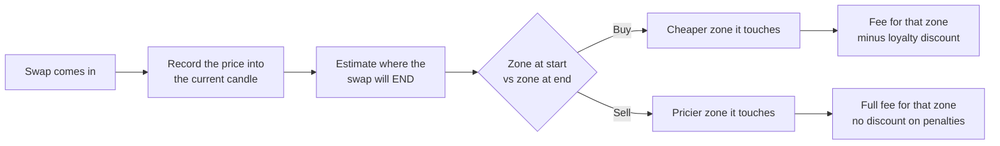
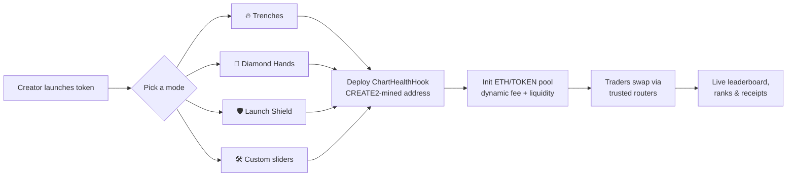

<div align="center">

# 📈 Chart Health Hook

**A Uniswap v4 hook where every trade pays for what it does to the chart.**

Top blasters and dip buyers trade cheap. Extractors and paper hands pay up.<br/>
Loyal traders build an on-chain score that unlocks discounts.


</div>

---

## The game

Every ETH/TOKEN swap is placed on the recent chart and lands in one of four roles:

| | 🟢 Buy | 🔴 Sell |
|---|---|---|
| **⬆️ Top of the range** | 🚀 **Top Blaster**: pushing the chart. *Cheap fee, big score.* | 🧛 **Extractor**: selling into strength. *Higher fee, score down.* |
| **⬇️ Bottom of the range** | 💎 **Supporter**: buying the dip. *Cheap fee, score up.* | 🧻 **Paper Hands**: dumping the lows. *Highest fee, score down.* |
| **Middle / flat chart** | 😐 Neutral fee | 😐 Neutral fee |

Fees go to the LPs, and in v4 they're taken from the swap's input. So a 10% paper-hands fee means 10% of the dumped tokens never hit the curve, which directly softens the dump. LPs also earn the most exactly when the chart needs them most.

## How a swap is judged



1. **📊 Read the chart.**
   - The hook keeps candles of the TOKEN price for each pool. The *range* is the high and low across the current and previous candle.
   - The top `zoneBps` of the range is the top zone, and the bottom `zoneBps` is the bottom zone.
   - A range narrower than `minRangeTicks` counts as a flat chart, so every swap is neutral.
2. **🎯 Judge where the trade *ends*, not just where it starts.**
   - The hook estimates the post-swap price from the pool's liquidity and the swap's price limit.
   - **Sells pay the worst zone they touch**, so a whale dumping from the middle all the way to the lows still pays the paper-hands fee.
   - **Buys get the best zone they touch**, so a breakout buy from a flat chart is a top blast, and a big dip buy that lifts the price keeps its supporter fee.
3. **🏅 Score the trader.**
   - Swaps through **trusted routers** reveal the real trader via `IMsgSender.msgSender()`. Uniswap's Universal Router supports this.
   - Those trades change the trader's public score by `weight × ETH volume`.
   - The score **decays**: it halves every `scoreHalfLife`, so it reflects how you've traded recently, not your lifetime history.
4. **💸 Discount loyal traders.**
   - A positive score unlocks a discount that scales linearly up to `maxDiscountBps`, which is reached at `fullDiscountScore`.
   - **Discounts never apply to penalty trades**, so a high-score whale still pays full price to dump.
   - A negative score adds no extra penalty. A fresh wallet could dodge it anyway, and the per-trade fee already handles bad timing.

**Who pays what:**
- **Untrusted routers and aggregators** still pay the zone fee, so the chart is protected from every direction. They just don't earn score or discounts.
- **Any contract** can read `scoreOf(trader)` and `discountBps(trader)`, for example for airdrops, gated perks, leaderboards or labeling wallets.

### Ranks

The contract stores a single number. A frontend can turn it into ranks:

| Score | Discount | Rank |
|---|---|---|
| < 0 | 0% | 🧻 Paper Hands |
| 0 | 0% | 🐸 Tourist |
| up to 25% of full | up to 25% of max | 💎 Supporter |
| up to 75% of full | up to 75% of max | 🚀 Top Blaster |
| ≥ full | max | 👑 Chart Guardian |

---

## Presets

Three ready-made setups in [`src/ChartHealthPresets.sol`](src/ChartHealthPresets.sol), plus a fully custom option.

| | 🔥 **Trenches** | 💎 **Diamond Hands** | 🛡️ **Launch Shield** |
|---|---|---|---|
| **For** | Fast degen memecoins | Community tokens with long-term holders | Brand-new launches |
| **Vibe** | Send it. Dumping the lows costs 8%. | Buying the dip is the best trade. | Survive the first days. |
| Candle | 15 min | 4 h | 5 min |
| Zones activate after | ~10% move (1,000 ticks) | ~16% move (1,500 ticks) | ~7% move (700 ticks) |
| Zone width | 25% | 25% | 30% |
| 😐 Neutral fee | 1% | 0.5% | 1% |
| 🚀 Top buy | **0.25%** | 0.3% | 0.5% |
| 💎 Bottom buy | 0.5% | **0.1%** | 0.3% |
| 🧛 Top sell | 3% | 1% | 5% |
| 🧻 Bottom sell | **8%** | 5% | **10%** |
| Score weights (🚀/💎/🧛/🧻) | +2 / +1 / −2 / −2 | +1 / +2 / −2 / −3 | +1 / +1 / −2 / −2 |
| Max discount | 75% | 50% | **100%** |
| Full discount at | 3 ETH | 10 ETH | 1 ETH |
| Score half-life | 3 days | 14 days | 7 days |

**🛠️ Custom:** every field is configurable.
- Fees can go from 0% to 100%.
- Discounts can go up to 100% off.
- Weights can rank top blasting above dip buying, or the other way round.

Start from any preset and tweak it in [`custom()`](script/DeployChartHealthHook.s.sol).

> **Tuning tips:**
> - `neutralFee` matters most: it's what most swaps pay.
> - Set `fullDiscountScore` to about 10–30× a typical buy.
> - Keep the highest sell fee at or below about 10%. Scanners may flag higher sell taxes as honeypots.

---

## 🚀 Launchpad concept

Chart Health Hook is built to be the engine of a token launchpad where **every launch picks its trading personality**:



**What the launchpad would show:**
- **Mode picker on the launch page.** One click for a preset, or **Custom** mode with sliders for every fee, weight, zone and discount. A live preview shows what a 1 ETH dump or a top blast would cost.
- **Swap receipts that turn fees into gameplay.** For example: *"🚀 TOP BLAST: 0.06% fee (75% loyalty discount) · +2 score/ETH"* or *"🧻 PAPER HANDS: 8% fee · −2 score/ETH"*.
- **A leaderboard per token.** Ranks come from `scoreOf`. Chart Guardians get airdrops, allowlists and perks from the creator.
- **A chart overlay** with the live top and bottom zones drawn over the candles, so traders can see which fee they're about to pay.
- **Graduation.** A token launches on 🛡️ Launch Shield and, once it stabilizes, the community migrates liquidity to a calmer 🔥 Trenches or 💎 Diamond Hands pool. A hook's config is permanent, so modes change by moving to a new pool.
- **Cross-token reputation.** Because scores are public, a launchpad can show a trader's track record across every Chart Health token. Serial paper hands get spotted fast.

**What's built and what isn't:**
- **Built here:** the hook, the presets, and a deploy script that mines the hook address for any mode.
- **The launchpad's job:** the token factory, the pool and liquidity setup, and the frontend.

---

## Repo

```
src/ChartHealthHook.sol            the hook
src/ChartHealthPresets.sol         Trenches / Diamond Hands / Launch Shield configs
script/DeployChartHealthHook.s.sol deploy any preset or a custom config
test/ChartHealthHook.t.sol         tests
```

### Test

```bash
git clone --recursive https://github.com/Markeljan/chart-health-hook
cd chart-health-hook
forge test
```

The tests:
- use Uniswap's real `V4Router` (from v4-periphery) as the trusted router and `PoolSwapTest` as an untrusted one;
- assert the fee actually charged, read from the PoolManager's `Swap` event;
- cover every zone, dumps from a flat chart and from the middle of the range, exact-output dumps, the candle window, scoring, discounts, decay, and wash-trading round trips.

### Deploy

```bash
POOL_MANAGER=0x... TRUSTED_ROUTERS=0x...,0x... PRESET=trenches \
forge script script/DeployChartHealthHook.s.sol --rpc-url $RPC_URL --private-key $PK --broadcast
```

- `PRESET` is one of `trenches`, `diamond`, `shield` or `custom`.
- `TRUSTED_ROUTERS` should list routers that implement `msgSender()`, such as the Universal Router.
- Then initialize an **ETH/TOKEN** pool (`currency0` = native ETH) with `fee = LPFeeLibrary.DYNAMIC_FEE_FLAG`. Any other pool reverts with `InvalidPool`.

---

## Design notes

- **End-price estimate.** The estimate assumes the liquidity currently in range holds for the whole swap. It's exact for full-range liquidity and a close estimate for concentrated positions.
- **Trader identity.** The trader is only known for routers that report `msgSender()`. Aggregator and solver flow pays the zone fees but doesn't earn score.
- **Wash trading.** In every preset, sell weights are at least as heavy as buy weights. A buy-and-sell round trip in the same zone therefore scores at most 2× what the trader lost to fees and price impact, so score can't be farmed for free.
- **Only bites on the main venue.** Penalty fees only work if this pool is where the token mainly trades. Deep liquidity elsewhere lets sellers route around it.
- **Permanent config.** Settings are fixed per hook. That means no admin key, and it also means a new mode requires a new pool.

<div align="center">

Built for the Uniswap v4 Hooks Incubator · started from [haardikk21/points-hook](https://github.com/haardikk21/points-hook)

</div>
